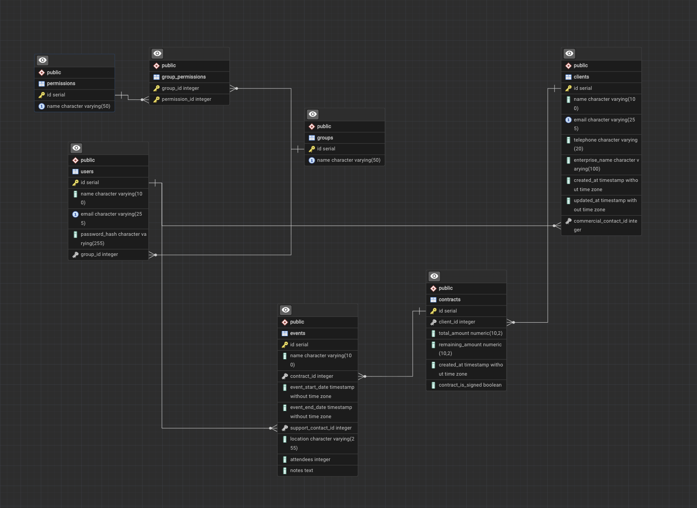

# Epic Events — CRM

Application CRM (Customer Relationship Management) en ligne de commande pour Epic Events,
entreprise d'organisation d'événements. Elle permet de gérer de façon sécurisée les clients,
les contrats et les événements, avec des droits différents selon le département du
collaborateur (gestion, commercial, support).

> Projet en cours de développement : la base de données, les modèles et le hachage des
> mots de passe sont en place. L'authentification, les opérations CRUD et l'interface
> en ligne de commande sont à venir.

## Technologies

- Python 3.9 ou plus récent
- PostgreSQL (testé avec la version 18)
- SQLAlchemy 2 (ORM) et psycopg 3 (driver PostgreSQL)
- Argon2 (hachage des mots de passe)
- python-dotenv (configuration par variables d'environnement)

## Installation

### 1. Prérequis

- **Python 3.9+** : vérifier avec `python3 --version`.
- **PostgreSQL** installé et démarré, avec un compte **super-utilisateur** dont vous
  connaissez le nom (et le mot de passe s'il en a un).
  - macOS (Homebrew) :
    ```bash
    brew install postgresql@18
    brew services start postgresql@18
    ```
    Le super-utilisateur porte alors votre nom d'utilisateur macOS, sans mot de passe.
  - Windows / Linux : installer PostgreSQL depuis https://www.postgresql.org/download/.
    Le super-utilisateur s'appelle généralement `postgres`.

### 2. Récupérer le projet et installer les dépendances

```bash
git clone <url-du-depot>
cd <dossier-du-projet>
python3 -m venv env
source env/bin/activate          # Windows : env\Scripts\activate
pip install -r requirements.txt
```

### 3. Configurer le fichier `.env`

Copier le modèle, puis l'ouvrir et renseigner **toutes** les valeurs :

```bash
cp .env.example .env
```

| Variable | Rôle |
|---|---|
| `DB_HOST`, `DB_PORT` | Adresse du serveur PostgreSQL (`localhost`, `5432` par défaut). |
| `DB_NAME` | Nom de la base à créer (`epicevents`). |
| `DB_ADMIN_USER`, `DB_ADMIN_PASSWORD` | Super-utilisateur PostgreSQL **existant**. Utilisé uniquement par `init_db.py` pour créer les comptes et la base. Laisser le mot de passe vide s'il n'en a pas. |
| `DB_OWNER_USER`, `DB_OWNER_PASSWORD` | Compte **propriétaire** de la base, créé par `init_db.py` avec ce mot de passe. Sert uniquement à créer les tables. |
| `DB_APP_USER`, `DB_APP_PASSWORD` | Compte **applicatif**, créé par `init_db.py` avec ce mot de passe. Utilisé par le CRM, avec des droits limités. |

Choisissez des mots de passe robustes pour les comptes propriétaire et applicatif :
c'est `init_db.py` qui crée ces comptes avec les mots de passe que vous inscrivez ici.

> Le fichier `.env` contient des secrets : il est ignoré par Git et ne doit **jamais**
> être versionné.

### 4. Initialiser la base de données

```bash
python init_db.py
```

Le script effectue, dans l'ordre :

1. la création des comptes `DB_OWNER_USER` et `DB_APP_USER` (sans aucun privilège
   global) avec les mots de passe du `.env` ;
2. la création de la base `DB_NAME`, dont seul le compte applicatif peut se connecter ;
3. la création des tables, avec le compte propriétaire ;
4. l'insertion des 3 départements et de leurs permissions (`seed.py`).

Résultat attendu :

```
1/4 Comptes epicevents_owner et epicevents_app prêts.
2/4 Base epicevents prête.
3/4 Tables créées.
4/4 Départements et permissions insérés.
```

Le script peut être relancé sans risque : il ne recrée pas ce qui existe déjà
(il met seulement à jour les mots de passe des comptes avec ceux du `.env`).

### 5. Vérifier la connexion

```bash
python database.py
```

Doit afficher `Connexion OK : epicevents_app sur la base epicevents (...)`.

### 6. (Recommandé) Exiger les mots de passe côté PostgreSQL

Certaines installations (notamment Homebrew) acceptent les connexions locales **sans mot
de passe** (méthode `trust`). Pour l'interdire, remplacer `trust` par `scram-sha-256` dans
le fichier `pg_hba.conf` (son emplacement s'obtient avec `psql postgres -c 'SHOW hba_file'`),
puis redémarrer PostgreSQL. Pensez à définir d'abord un mot de passe pour le
super-utilisateur (`\password` dans `psql`) et à le reporter dans `DB_ADMIN_PASSWORD`.

## Sécurité

- **Moindre privilège** : le CRM se connecte avec un compte qui peut seulement lire et
  écrire des données (`SELECT`, `INSERT`, `UPDATE`, `DELETE`). Il ne peut ni créer, ni
  modifier, ni supprimer de tables, et lui seul peut se connecter à la base du CRM.
- **Aucun secret dans le code** : identifiants lus depuis le `.env`, ignoré par Git.
- **Mots de passe des collaborateurs** : jamais stockés en clair, uniquement leur
  empreinte Argon2id salée (`security.py`).
- **Injections SQL** : toutes les requêtes passent par l'ORM SQLAlchemy ou par des
  requêtes paramétrées.
- **Cohérence des données** : contraintes vérifiées par PostgreSQL (montant restant
  compris entre 0 et le montant total, date de fin après la date de début, nombre de
  participants positif).

## Rôles et permissions

Chaque collaborateur appartient à un département, qui détermine ses permissions :

| Permission | Gestion | Commercial | Support |
|---|:---:|:---:|:---:|
| `read_clients`, `read_contracts`, `read_events` | ✅ | ✅ | ✅ |
| `create_own_client`, `update_own_client` | | ✅ | |
| `update_own_contract` | | ✅ | |
| `create_event` | | ✅ | |
| `create_contract`, `update_contract` | ✅ | | |
| `update_event` | ✅ | | |
| `create_user`, `update_user`, `delete_user` | ✅ | | |
| `update_own_event` | | | ✅ |

Les permissions `own` ne s'appliquent qu'aux éléments dont le collaborateur est
responsable (ses clients, les contrats de ses clients, ses événements).

## Schéma de la base de données



| Table | Contenu |
|---|---|
| `users` | Collaborateurs (nom, email, empreinte du mot de passe, département) |
| `groups` | Départements : gestion, commercial, support |
| `permissions` | Permissions |
| `group_permissions` | Association départements ↔ permissions |
| `clients` | Clients, rattachés à leur commercial |
| `contracts` | Contrats, rattachés à un client |
| `events` | Événements, rattachés à un contrat et (éventuellement) à un support |

## Structure du projet

```
├── database.py      # connexion à PostgreSQL à partir du .env
├── models.py        # modèles SQLAlchemy (tables, relations, contraintes)
├── security.py      # hachage et vérification des mots de passe (Argon2)
├── seed.py          # départements, permissions et leurs associations
├── init_db.py       # initialisation complète de la base
├── docs/
│   └── schema_bdd.png
├── .env.example     # modèle de configuration
└── requirements.txt
```
